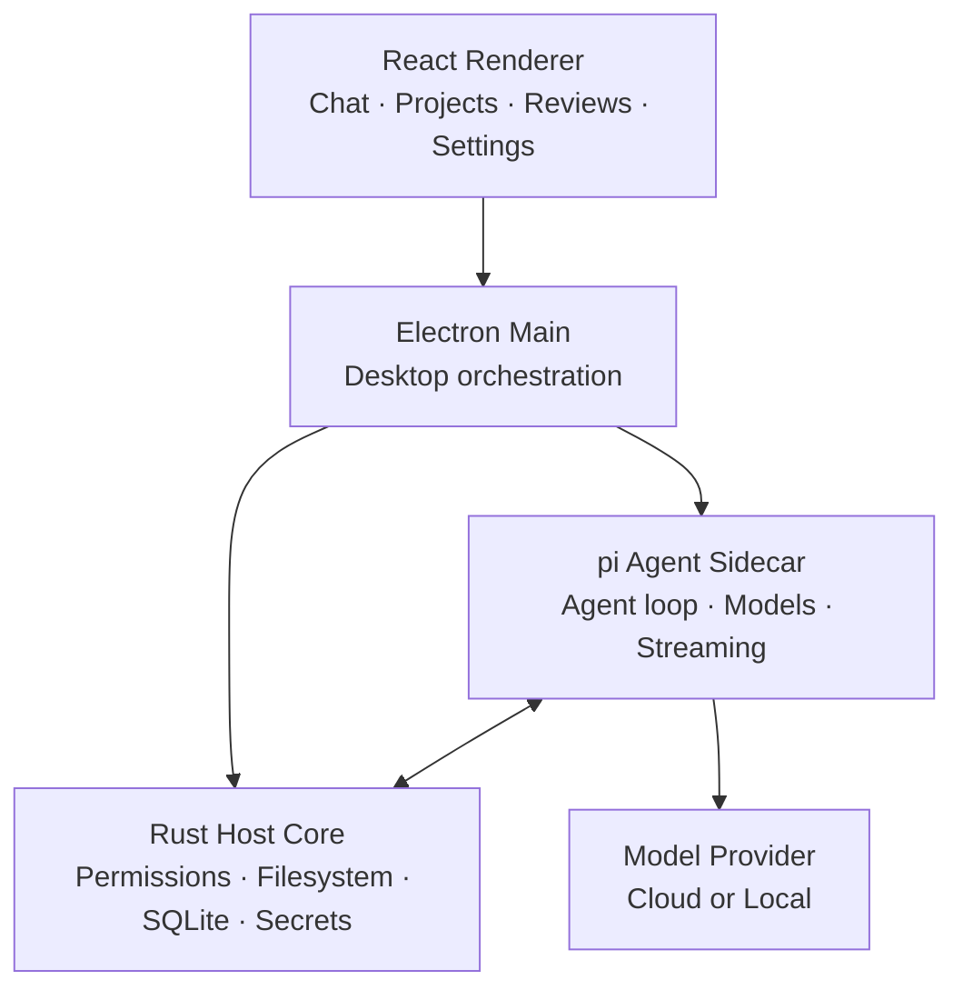

<div align="center">


# 京车小智工作台

### Jingche Xiaozhi Workbench — a local-first desktop workspace for AI agents.

**Bring your own model. Open any local project. Let agents work — while you keep the approvals.**

Local-first · Model-agnostic · Extensible · Windows / macOS / Linux

<br />

[](https://github.com/zhangsa69/jingche-xiaozhi-workbench/releases/latest)
[](https://github.com/zhangsa69/jingche-xiaozhi-workbench/releases)
[](https://github.com/zhangsa69/jingche-xiaozhi-workbench/stargazers)
[](https://github.com/zhangsa69/jingche-xiaozhi-workbench/actions/workflows/ci.yml)
[](LICENSE)

<br />

**[Download](https://github.com/zhangsa69/jingche-xiaozhi-workbench/releases/latest)** ·
[Documentation](docs/spec/README.md) ·
[Screenshots](docs/guide/screenshots.md) ·
[Build a plugin](docs/plugin-development.md) ·
[简体中文](README.zh-CN.md)

<br />


<br />

**No account. No mandatory relay. No editor lock-in.**

<sub>Projects and sessions stay on your machine. Model requests go straight to the provider or endpoint you configure.</sub>

</div>

---

> [!IMPORTANT]
> **京车小智工作台 is in early preview.** Current version: `0.14.8-native.1`. It is usable for real work, but interfaces and desktop behaviours are still moving.

## Not another chat window

Projects, sessions, files, diffs, previews, models, permissions, extensions, and long-running work live together in one desktop environment.

<table>
<tr>
<td width="50%" valign="top">

### Your models

Use OpenAI, Anthropic, local models, hosted gateways, or any OpenAI-compatible API.

Configure multiple providers, context windows, output limits, reasoning levels, and model-specific behaviour. Switch models from the Composer without rebuilding the session. Ollama and LM Studio are one click away under local model presets.

</td>
<td width="50%" valign="top">

### Your projects

Open a local repository or project directory and keep its sessions, files, reviews, previews, and agent work in one place.

Import existing local sessions from Claude Code, Codex, OpenCode, and Pi.

</td>
</tr>
<tr>
<td width="50%" valign="top">

### Your control

Agents read files, edit code, and run commands, while privileged actions pass through the permission layer.

Inspect diffs, read command output, and decide how much autonomy each session gets. A built-in privacy page spells out what goes upstream and what stays local.

</td>
<td width="50%" valign="top">

### Your extensions

Add Skills, MCP servers, Subagents, pi extensions, and installable plugins.

Extend the agent **and** the desktop instead of waiting for every workflow to become a built-in feature.

</td>
</tr>
</table>

---

## One workspace, four ways to work

Same agent, different approval boundaries.

| | **Agent** | **Plan** | **Goal** | **Ask** |
| --- | --- | --- | --- | --- |
| **You approve** | Nothing extra | The implementation plan | The outcome and acceptance criteria | Nothing — it cannot write |
| **The agent does** | Reads, edits, runs commands, tests, iterates | Studies the repo, writes a frozen plan, then waits | Chooses the path and works toward the goal | Answers questions over the project |
| **Best for** | Day-to-day work | Large or risky changes | Outcome-first tasks | Understanding code safely |

Privileged tools still go through the permission layer in every mode.

---

## What this workbench adds

Beyond the agent loop, the desktop carries the parts of a task that usually fall on the floor:

| Area | What you get |
| --- | --- |
| **Delivery** | Artifact chips, in-panel preview for `docx` / `xlsx` / `pptx` and PDF, save-as into a folder you pick |
| **Transparency** | Command and log tabs, reply wall-clock, thinking timer, numbered tool rows with per-call timing |
| **Work history** | Task history by day, with re-run, re-use input, and re-use workspace |
| **Experts** | Expert centre with 12 domain presets, plus team dispatch that folds several experts into one deliverable |
| **Context** | Local library referenced with `@`, earlier conversations and snippets referenced with `#`, explicit context picking with a character budget |
| **Reuse** | Prompt library with favourites, tags, and `↑` recall on an empty composer |
| **Sessions** | Session tab bar over the conversation list, and a side chat that leaves the main thread untouched |
| **Files** | `@` file references, slash commands, drag-and-drop, large-paste capture into session temp files |

### See the work, not just the answer

<table>
<tr>
<td width="50%">


<p align="center"><sub>Long-running conversations with transcript navigation</sub></p>

</td>
<td width="50%">


<p align="center"><sub>Switch providers, models, and reasoning levels per session</sub></p>

</td>
</tr>
<tr>
<td width="50%">


<p align="center"><sub>Extend the workspace through the plugin marketplace</sub></p>

</td>
<td width="50%">


<p align="center"><sub>Add a provider and connect a model</sub></p>

</td>
</tr>
</table>

<p align="center">
<a href="docs/guide/screenshots.md"><strong>Explore all screenshots →</strong></a>
</p>

---

## Extend the workspace instead of rebuilding it

| Layer | What it does |
| --- | --- |
| **Plugins** | Agent tools, commands, Skills, workspace panels, themes, MCP servers, Subagents, resident services, inter-plugin messaging — packaged as `.piplug` and installable from the marketplace |
| **Skills** | Reusable instructions and workflows, global or per project |
| **MCP** | External tools and services through Model Context Protocol servers |
| **pi extensions** | Extensions written for the [pi](https://github.com/badlogic/pi-mono) CLI run unchanged, gated by the `agent.extension` permission |
| **Subagents** | Independent work delegated to background agents, each in its own context |

Built-in plugins: `pi.office` (document delivery), `pi.browser`, `pi.file-manager`.

PI-Desktop can also be driven by an external MCP agent: start with `PI_DESKTOP_MCP_CONTROL=1` and read the loopback endpoint plus bearer token from `mcp-control.json` in the Electron user-data directory. It is disabled by default, binds to loopback only, and grants the caller the same authority as the desktop. `confirm: true` is not a user prompt.

> [!NOTE]
> Plugin processes are permission-gated and isolated from the renderer, but plugins are user-trusted code rather than an operating-system sandbox. Only install plugins you trust.

---

## Local-first, precisely

| Data | Behaviour |
| --- | --- |
| Conversations | Local JSONL with a SQLite index |
| Settings | On your machine |
| API credentials | Operating-system keychain |
| Logs | Local |
| Telemetry | None |
| Model requests | Sent directly to the provider or endpoint you configure |

There is no required account and no mandatory hosted relay between your machine and your model provider. If you use a remote provider, the context needed for that request goes to that provider under its own privacy policy.

---

## Download

| Platform | Architecture | Package |
| --- | --- | --- |
| Windows | x64 | NSIS installer · portable `.exe` |
| macOS | Apple Silicon / Intel | `.dmg` · `.zip` |
| Linux | x64 | `.AppImage` · `.deb` · `.rpm` · `.asar` |

Windows artifacts are named `JingcheWorkbench-Setup-<version>.exe` and `JingcheWorkbench-Portable-<version>.exe`.

<details>
<summary><strong>Windows notes</strong></summary>

<br />

The installer is per-user by default, lets you choose the install directory, and creates a Start menu entry named 京车小智工作台. The portable build keeps everything in one executable and stores data under the usual Electron user-data directory.

Packaged builds can check GitHub Releases for updates. The NSIS installer can download and install updates in place; the portable executable opens the releases page instead.

</details>

<details>
<summary><strong>macOS notes</strong></summary>

<br />

Tagged releases publish unsigned macOS artifacts by default. If macOS reports the app as damaged, move it to `/Applications` and run:

```bash
xattr -r -d com.apple.quarantine "/Applications/京车小智工作台.app"
```

The command only removes Apple's quarantine attribute. Do not use it for an untrusted app.

</details>

---

## Build from source

### Requirements

- Node.js `>=22.19` (CI and release builds use Node 24)
- pnpm `>=10`
- stable Rust toolchain

### Run

```bash
git clone https://github.com/zhangsa69/jingche-xiaozhi-workbench.git
cd jingche-xiaozhi-workbench

pnpm install
cargo build -p host-core
pnpm build:js
pnpm dev
```

### Build the Windows installer

```bash
cd apps/desktop
pnpm dist:win
```

This runs the dependency builds, a release build of the Rust host, the agent-runtime bundle, the Electron/Vite build, then electron-builder for `nsis` and `portable`. Artifacts land in `apps/desktop/release/`.

Use `pnpm dist:mac` or `pnpm dist:linux` for the other platforms. If the Electron download stalls behind a slow link to GitHub, set `ELECTRON_MIRROR` for that shell before packaging.

### Validate changes

```bash
node scripts/run-gates.mjs          # desktop suite + style tokens + types
node scripts/run-gates.mjs --all    # also shared, agent-runtime, i18n, host-core
```

### Documentation

```bash
pnpm docs:dev
pnpm docs:check
```

Useful references:

- [Specification index](docs/spec/README.md)
- [Architecture](docs/spec/02-architecture/01-architecture.md)
- [Product scope](docs/spec/01-product/01-product-scope.md)
- [Plugin development](docs/plugin-development.md)
- [Release runbook](docs/spec/06-delivery/06-release-runbook.md)
- [Repository agent guide](AGENTS.md)

---

## Project status

Current line: **`0.14.8-native.1`**.

Delivered: the desktop shell, streaming agent runtime, Agent / Plan / Goal / Ask modes, permission-aware workspace tools, projects and sessions, session import, local MCP control, plugins / Skills / MCP / Subagents, multi-provider model configuration with local model presets, context checkpoints, notifications, release notes, cross-platform packaging, plus the delivery, history, expert, context, and prompt-reuse features listed above.

Not in this build:

- the template system and voice input were implemented and then removed at the user's request;
- automatic model routing and a connector marketplace were cancelled;
- the mobile companion page, webhooks, local backup, multi-window, LSP tooling, and scheduled dispatch are not started.

Follow development through the [project board](docs/project/BOARD.md) and the [self-driving queue](docs/自驱动队列.md).

---

## Architecture



The renderer has no Node integration. The **Rust Host Core** owns privileged workspace operations, permissions, persistence, and secrets; the **pi Agent Sidecar** owns model interaction and the agent loop; Electron coordinates the desktop lifecycle.

---

## Built on pi

The agent runtime uses [`pi-ai` and `pi-agent-core`](https://github.com/badlogic/pi-mono).

This workbench started from [PI-Desktop](https://github.com/vastsa/PI-Desktop) and has since been rebranded, re-themed, and extended with the delivery, expert, library, prompt, session-tab, and context features described above.

It also uses Electron, React, TypeScript, Rust, SQLite, Vite, Tailwind CSS, Shiki, Mermaid, KaTeX, TypeBox, and i18next.

---

## Contributing

Issues, bug reports, feature proposals, documentation improvements, plugins, Skills, MCP integrations, and pull requests are welcome. For larger changes, opening an issue first makes it easier to align the implementation with the existing architecture and product contracts.

Start with [AGENTS.md](AGENTS.md) and the [specification index](docs/spec/README.md).

**[Report an issue](https://github.com/zhangsa69/jingche-xiaozhi-workbench/issues/new/choose)** ·
[View open issues](https://github.com/zhangsa69/jingche-xiaozhi-workbench/issues)

---

## License

**GNU Lesser General Public License v3.0**. See [LICENSE](LICENSE).

---

<div align="center">

### Build with the model you want. Keep the workflow yours.

**[Download 京车小智工作台](https://github.com/zhangsa69/jingche-xiaozhi-workbench/releases/latest)**

<sub>Windows · macOS · Linux</sub>

</div>
