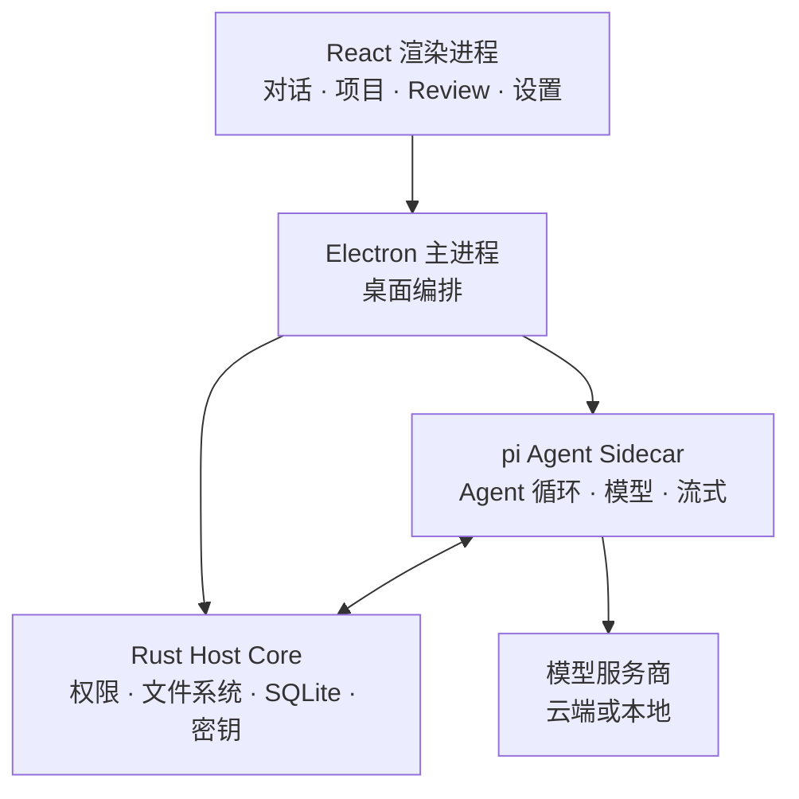

<div align="center">


# 京车小智工作台

### 给 AI Agent 一个本地优先的桌面工作台。

**模型随便换，项目直接开，Agent 放手干活，审批权始终在你手上。**

本地优先 · 模型自由 · 可扩展 · Windows / macOS / Linux

<br />

[](https://github.com/zhangsa69/jingche-xiaozhi-workbench/releases/latest)
[](https://github.com/zhangsa69/jingche-xiaozhi-workbench/releases)
[](https://github.com/zhangsa69/jingche-xiaozhi-workbench/stargazers)
[](https://github.com/zhangsa69/jingche-xiaozhi-workbench/actions/workflows/ci.yml)
[](LICENSE)

<br />

**[立即下载](https://github.com/zhangsa69/jingche-xiaozhi-workbench/releases/latest)** ·
[规格文档](docs/spec/README.md) ·
[界面预览](docs/guide/screenshots.md) ·
[开发插件](docs/plugin-development.md) ·
[English](README.md)

<br />


<br />

**不绑账号 · 不强制走中转 · 不锁定编辑器**

<sub>项目和会话留在你的电脑里，模型请求直接发到你配置的服务商或 Endpoint。</sub>

</div>

---

> [!IMPORTANT]
> **京车小智工作台目前处于早期预览阶段。** 当前版本：`0.14.8-native.1`。日常干活已经够用，但接口与部分桌面行为仍在演进。

## 不是又一个聊天框

项目、会话、文件、Diff、预览、模型、权限、扩展和长任务，都在同一个桌面环境里。

<table>
<tr>
<td width="50%" valign="top">

### 模型你自己选

OpenAI、Anthropic、本地模型、自建网关、OpenAI Compatible API 都能接。

每个模型可以单独配置上下文长度、最大输出、推理等级和模型特有行为；会话不用重建，直接在输入框里换模型。Ollama 与 LM Studio 在「本地模型预设」里一键添加。

</td>
<td width="50%" valign="top">

### 项目就在本地

打开本地仓库或任意项目目录，会话、文件、Review、预览和 Agent 的执行过程都在一处。

已经在用 Claude Code、Codex、OpenCode 或 Pi？可以导入已有的本地会话。

</td>
</tr>
<tr>
<td width="50%" valign="top">

### 能干活的 Agent，也有刹车

Agent 可以读文件、改代码、跑命令，高权限操作一律经过权限层。

你可以看 Diff、看命令输出，决定这个会话放多大的权限。应用内还有一页隐私说明，讲清什么会上行、什么只留在本机。

</td>
<td width="50%" valign="top">

### 不够用就自己扩展

Skills、MCP、Subagents、pi extensions、插件都可以接。

不只是给 Agent 加工具，还能给整个桌面加新面板、新视图、新主题、常驻服务。

</td>
</tr>
</table>

---

## 一个工作台，四种做事方式

同一个 Agent，不同的审批边界。

| | **智能体** | **规划** | **目标** | **问一问** |
| --- | --- | --- | --- | --- |
| **你批什么** | 不用额外批 | 这份实施计划 | 结果与验收标准 | 不用批——它不能写 |
| **Agent 做什么** | 读、改、跑命令、测试、迭代 | 先读仓库，产出一份冻结的计划，然后等你 | 自己选路径，朝目标推进 | 只回答关于项目的问题 |
| **适合** | 日常开发 | 大改、风险改动 | 结果导向的任务 | 安全地读懂代码 |

任何模式下，高权限工具仍然要过权限层。

---

## 这个工作台多做了什么

Agent 循环之外，那些平时容易掉在地上的环节，这里都有落点：

| 领域 | 你得到什么 |
| --- | --- |
| **交付** | 产物标签、`docx` / `xlsx` / `pptx` 与 PDF 面板内预览、另存到你选的目录 |
| **过程可见** | 命令与日志两个标签、回复墙钟、思考计时、带序号与单次耗时的工具行 |
| **工作历史** | 按天分组的任务历史，可重跑、只复用输入、复用工作空间 |
| **专家** | 专家中心 12 份领域预设，专家团把多位专家的结果汇总成一份交付物 |
| **上下文** | 本地资料库用 `@` 引用、历史会话与片段用 `#` 引用、显式挑选上下文（带字符预算） |
| **复用** | 提示词库：收藏、标签、空输入框按 `↑` 倒序回溯 |
| **会话** | 会话标签栏，以及不打断主对话的侧边聊天 |
| **文件** | `@` 文件引用、斜杠命令、拖放、大段粘贴落成会话临时文件 |

### 看得到过程，不只看结论

<table>
<tr>
<td width="50%">


<p align="center"><sub>长会话也能翻回去看清楚</sub></p>

</td>
<td width="50%">


<p align="center"><sub>每个会话独立选服务商、模型与推理等级</sub></p>

</td>
</tr>
<tr>
<td width="50%">


<p align="center"><sub>通过插件市场扩展工作台</sub></p>

</td>
<td width="50%">


<p align="center"><sub>添加服务商、接入模型</sub></p>

</td>
</tr>
</table>

<p align="center">
<a href="docs/guide/screenshots.md"><strong>查看全部界面预览 →</strong></a>
</p>

---

## 扩展工作台，而不是重造工作台

| 层 | 能做什么 |
| --- | --- |
| **插件** | Agent 工具、命令、Skills、工作区面板、主题、MCP 服务、Subagents、常驻服务、插件间消息；打成 `.piplug`，可从插件市场安装 |
| **Skills** | 可复用的指令与工作流，全局或按项目启用 |
| **MCP** | 通过 Model Context Protocol 接外部工具与服务 |
| **pi extensions** | 为 [pi](https://github.com/badlogic/pi-mono) CLI 写的扩展可以原样跑，受 `agent.extension` 权限约束 |
| **Subagents** | 把独立工作派给后台子代理，各自拥有独立上下文 |

内置插件：`pi.office`（文档交付）、`pi.browser`、`pi.file-manager`。

也可以用外部 MCP Agent 驱动本应用：以 `PI_DESKTOP_MCP_CONTROL=1` 启动，从 Electron 用户数据目录下的 `mcp-control.json` 读取回环地址与 bearer token。该能力默认关闭、只绑回环，且授予调用方与桌面同等的权限；`confirm: true` 不等于弹窗确认。

> [!NOTE]
> 插件进程有权限门禁、与渲染进程隔离，但插件仍是用户自担风险的代码，不是操作系统级沙箱。只装你信任的插件。

---

## 本地优先，具体到每一项

| 数据 | 行为 |
| --- | --- |
| 会话 | 本地 JSONL，配 SQLite 索引 |
| 设置 | 存在你的电脑上 |
| API 凭据 | 操作系统钥匙串 |
| 日志 | 本地 |
| 遥测 | 无 |
| 模型请求 | 直接发往你配置的服务商或 Endpoint |

不需要账号，也没有强制经过的托管中转。使用远端服务商时，这次请求所需的上下文会按该服务商自己的隐私政策发给他们。

---

## 下载

| 平台 | 架构 | 包 |
| --- | --- | --- |
| Windows | x64 | NSIS 安装包 · 便携版 `.exe` |
| macOS | Apple Silicon / Intel | `.dmg` · `.zip` |
| Linux | x64 | `.AppImage` · `.deb` · `.rpm` · `.asar` |

Windows 产物命名为 `JingcheWorkbench-Setup-<版本>.exe` 与 `JingcheWorkbench-Portable-<版本>.exe`。

<details>
<summary><strong>Windows 说明</strong></summary>

<br />

安装包默认按当前用户安装，可自选安装目录，开始菜单快捷方式名为「京车小智工作台」。便携版是单个 exe，数据仍写在 Electron 常规的用户数据目录。

打包版本可以检查 GitHub Releases 并提示新版本：NSIS 安装版能直接下载安装，便携版则打开 releases 页面。

</details>

<details>
<summary><strong>macOS 说明</strong></summary>

<br />

带标签的发布默认产出未签名的 macOS 产物。如果系统提示应用已损坏，先把它移到 `/Applications`，然后执行：

```bash
xattr -r -d com.apple.quarantine "/Applications/京车小智工作台.app"
```

这条命令只是去掉 Apple 的隔离属性，不要用在来路不明的应用上。

</details>

---

## 从源码构建

### 环境要求

- Node.js `>=22.19`（CI 与发布构建用 Node 24）
- pnpm `>=10`
- 稳定的 Rust 工具链

### 跑起来

```bash
git clone https://github.com/zhangsa69/jingche-xiaozhi-workbench.git
cd jingche-xiaozhi-workbench

pnpm install
cargo build -p host-core
pnpm build:js
pnpm dev
```

### 打 Windows 安装包

```bash
cd apps/desktop
pnpm dist:win
```

依次执行依赖构建、Rust host 的 release 构建、agent-runtime 打包、Electron/Vite 构建，最后用 electron-builder 产出 `nsis` 与 `portable`，产物在 `apps/desktop/release/`。

其他平台用 `pnpm dist:mac` 或 `pnpm dist:linux`。若访问 GitHub 慢导致 Electron 下载卡住，可以在当次终端设置 `ELECTRON_MIRROR` 再打包。

### 提交前校验

```bash
node scripts/run-gates.mjs          # 桌面全量 + 样式令牌 + 类型
node scripts/run-gates.mjs --all    # 另外跑 shared / agent-runtime / i18n / host-core
```

### 文档

```bash
pnpm docs:dev
pnpm docs:check
```

常用入口：

- [规格索引](docs/spec/README.md)
- [架构](docs/spec/02-architecture/01-architecture.md)
- [产品范围](docs/spec/01-product/01-product-scope.md)
- [插件开发](docs/plugin-development.md)
- [发布手册](docs/spec/06-delivery/06-release-runbook.md)
- [仓库协作指南](AGENTS.md)

---

## 项目状态

当前版本：**`0.14.8-native.1`**。

已交付：桌面外壳、流式 Agent 运行时、智能体 / 规划 / 目标 / 问一问四种模式、带权限的工作区工具、项目与会话、会话导入、本地 MCP 控制、插件 / Skills / MCP / Subagents、多服务商模型配置与本地模型预设、上下文检查点、通知、更新日志、跨平台打包，以及上面列出的交付、历史、专家、上下文与提示词复用能力。

不在当前版本里：

- 模板体系与语音输入曾实现，后按要求整体移除；
- 自动选模型与连接器市场已取消，不再排期；
- 手机端页面、webhook、本地备份、多窗口、LSP 工具、定时调度都还没开工。

进展看[项目看板](docs/project/BOARD.md)与[自驱动队列](docs/自驱动队列.md)。

---

## 架构



渲染进程没有 Node 集成。**Rust Host Core** 负责高权限的工作区操作、权限、持久化与密钥；**pi Agent Sidecar** 负责模型交互与 Agent 循环；Electron 负责桌面生命周期编排。

---

## 建在 pi 之上

Agent 运行时使用 [`pi-ai` 与 `pi-agent-core`](https://github.com/badlogic/pi-mono)。

本项目从 [PI-Desktop](https://github.com/vastsa/PI-Desktop) 起步，之后完成了品牌与主题替换，并加上了上文所述的交付、专家、资料库、提示词、会话标签与上下文能力。

另外用到的技术：Electron、React、TypeScript、Rust、SQLite、Vite、Tailwind CSS、Shiki、Mermaid、KaTeX、TypeBox、i18next。

---

## 参与贡献

欢迎提 issue、报 bug、提需求、改文档、写插件 / Skills / MCP 集成，也欢迎直接开 PR。改动较大时建议先开一个 issue，便于和既有架构与产品契约对齐。

动手前先读 [AGENTS.md](AGENTS.md) 与[规格索引](docs/spec/README.md)。

**[提交 issue](https://github.com/zhangsa69/jingche-xiaozhi-workbench/issues/new/choose)** ·
[查看已有 issue](https://github.com/zhangsa69/jingche-xiaozhi-workbench/issues)

---

## 许可证

**GNU Lesser General Public License v3.0**，详见 [LICENSE](LICENSE)。

---

<div align="center">

### 用你想用的模型，留住你自己的流程。

**[下载京车小智工作台](https://github.com/zhangsa69/jingche-xiaozhi-workbench/releases/latest)**

<sub>Windows · macOS · Linux</sub>

</div>
